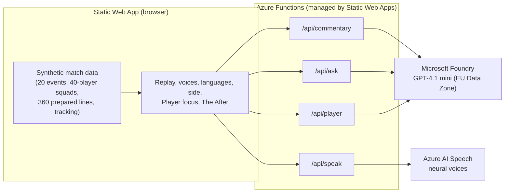
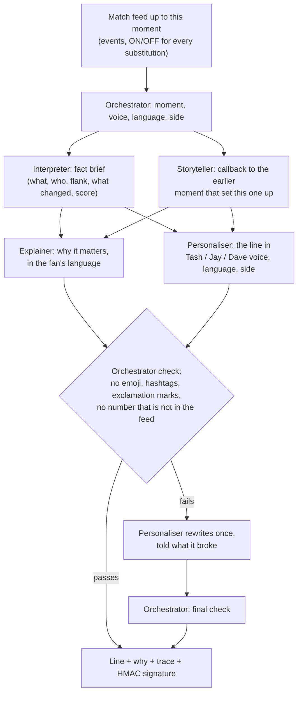

# The Room

**Made for every fan.** The match is the reason. The room is the difference.

The Room is The Sporting Society's second-screen football companion. One synthetic match is told live by three fictional AI personas, in the fan's language and from their chosen seat, by five agents running on Microsoft Foundry.

- **Tash** (Analyst): numbers first, then the reason.
- **Jay** (Casual): the story of the night in plain words.
- **Dave** (Banter): humour about the moment, never about people.

**Live demo, no login:** https://calm-flower-0ef5bb703.4.azurestaticapps.net

Entry for the Microsoft x Premier League *Inside the Game* hackathon, Synthetic Match Insights Engine category. All clubs, players, the competition, the venue and every event are fictional and synthetic. This is not a Premier League product and uses no league or club marks.

## Try it

1. Open the demo and press **Kick off**. The match replays moment by moment (1x, 2x or 4x), or you can step or scrub through it.
2. Pick a voice: Tash, Jay or Dave. Only that voice is shown. **Compare all three voices** shows them side by side.
3. Pick a language: EN, ES, FR, DE, PT or AR. Arabic switches the whole layout to right to left.
4. Pick your side: Neutral, NBR or KSU. The live voices then write from that seat.
5. Under any live line, open **How this line was made: five agents** to see what each agent did and how long it took.
6. **Ask** the current voice a question about the match. Answers use the match feed only.
7. Tap a player in **Player focus** for a stat card by position. At full time, **The After** adds a recap for that player.
8. Press **Voice off** to turn on spoken commentary (Azure AI Speech, a different voice per persona in each language).
9. **Live AI / Prepared**: Live AI writes every line as the moment happens. Prepared uses the team's checked lines in six languages. If the live service fails, the app falls back to Prepared.

The fixture: **Northbridge Athletic 3-2 Kingsport United**, Continental Crown, Meridian Park. Northbridge trail 2-1, Kian Holt comes on at 67', and his crosses set up the 84' equaliser and the 90+3 winner.

## Architecture



### The five agents (`app/api/src/functions/room.js`)



- **Orchestrator** is code. It runs the chain, checks each line against the house rules, sends it back once with the reason if it fails, and returns the trace the UI shows.
- **Interpreter** and **Storyteller** run in parallel. Their outputs are cached per moment and shared by every voice and language, so Tash, Jay and Dave always agree on the facts. This is why the agents are separate: one fact brief, many voices.
- **Explainer** and **Personaliser** run in parallel per voice, language and side.
- Every agent works only from the synthetic feed. Pitch orientation (whose left, whose right) and substitution direction (who comes ON, who goes OFF) are given explicitly, so no agent has to guess.
- **Speech** only reads lines this API wrote (HMAC-signed) or the team's prepared lines, so the endpoint cannot be used as a general text-to-speech service.

| Endpoint | Request | Response |
| --- | --- | --- |
| `POST /api/commentary` | `index` (0-19), `character`, `lang`, `club` (`none`, `home`, `away`) | `line`, `why`, `trace`, `model`, `sig`, timings |
| `POST /api/ask` | the same, plus `question` | `answer`, `model`, `sig` |
| `POST /api/player` | `player`, `character`, `lang`, `stats` | `recap`, `model`, `sig` |
| `POST /api/speak` | `text`, `character`, `lang`, `sig` or `prepared` | MP3 audio |

### Azure resources

| Resource | Purpose |
| --- | --- |
| Azure Static Web Apps (Free) | Hosts the page and its managed Azure Functions API (Node 18) |
| Azure AI Services / Microsoft Foundry, Sweden Central | `gpt-4.1-mini` deployment (Data Zone Standard, EU) for the agents, plus Azure AI Speech |
| Azure Cost Management budget | Spend alert on the resource group |

Keys live only in the Static Web App's application settings, never in the code or the page.

## Repository

```
app/
  src/index.html            the whole front end (HTML, CSS, JS), with a placeholder the build fills with the data
  src/faces/                fictional AI-generated persona portraits
  api/src/functions/room.js the five agents and the four endpoints
  build.py                  validates the dataset, fixes known conflicts, inlines the data, writes dist/ and api/src/match.json
  make_players.py           synthetic tracking for every player who took part, consistent with the feed
  translate_facts.py        one-off build-time translation of the 20 feed facts (output checked by hand: facts_i18n.json)
data/
  The_Room_Developer_Dataset_40_Player_v2.json / .csv   the synthetic match: 20 events, 40-player squads,
                                                        10 substitutions, 360 lines (20 moments x 3 voices x 6 languages)
```

## Run it locally

You need Python 3.10+, Node 18+ and the Azure Functions Core Tools v4.

```bash
cd app
python build.py                      # writes dist/ and api/src/match.json
cp api/local.settings.example.json api/local.settings.json   # then fill in your own endpoint and key
cd api && npm install && cd ..
npx @azure/static-web-apps-cli@2.0.2 start dist --api-location api
```

Open http://localhost:4280. Without an AI key, Prepared mode still works and Live AI falls back to the prepared lines.

To deploy to your own Static Web App:

```bash
npx @azure/static-web-apps-cli@2.0.2 deploy ./dist --api-location ./api --api-language node --api-version 18 \
  --deployment-token <from: az staticwebapp secrets list> --env production
```

Then set `AOAI_ENDPOINT`, `AOAI_KEY` and `AOAI_DEPLOYMENT` in the Static Web App's application settings.

## How it maps to the judging criteria

| Criterion | What The Room does | Where to see it |
| --- | --- | --- |
| Technological Implementation | Static Web Apps, managed Azure Functions, Microsoft Foundry and Azure AI Speech. A build step validates the synthetic data, a consistency check on every generated line, signed speech requests, and a fallback to prepared lines | `room.js`, `build.py`, the live demo |
| Agentic Design & Innovation | Five agents with separate jobs: shared fact and story agents, so three voices never contradict each other, plus a code Orchestrator that checks, retries and reports a trace | "How this line was made" under any live line |
| Real-World Impact & Applicability | The fan picks tone, language (6) and side, follows one player, and gets a full-time recap. The TSS WhatsApp community prompt at kick-off and in The After turns a second screen into a watch party | Language and side switches, Player focus, The After |
| User Experience & Presentation | One voice at a time, optional comparison, spoken voices, full Arabic RTL layout, works on a phone | The live demo on desktop and mobile |
| Adherence to the category | Synthetic, football-realistic events become live narratives, explanations and recaps for a second screen | The whole match replay |

## Limits

- One fixture. Penalty and red-card moments exist in the feed; there is no penalty goal.
- Translations of the interface and feed facts were machine-made and corrected by hand. A native-speaker review is welcome.
- Player tracking numbers (touches, distance, passes) are synthetic and labelled as such in the app. Goals, assists, saves and cards are counted from the feed.
- Live lines are generated, so they vary between runs. The Orchestrator check catches house-rule breaks and numbers that are not in the feed, not every possible error.

## Credits

The Room is a concept by The Sporting Society (TSS), built for the *Inside the Game* hackathon. Tash, Jay and Dave are fictional AI-generated personas. All match data is synthetic. The TSS name and branding belong to The Sporting Society. No open-source licence is granted unless one is added to this repository.
